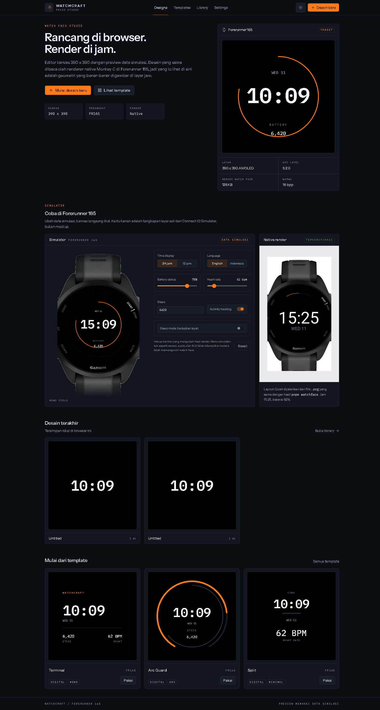
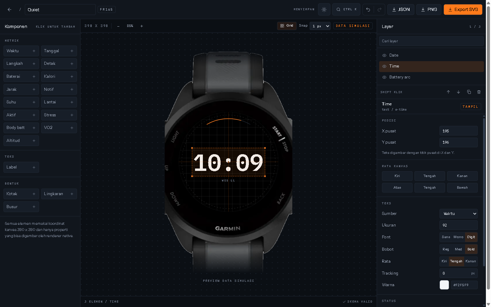

# WATCHCRAFT

[](https://github.com/albiruby/WatchCraft/actions/workflows/ci.yml)
[](LICENSE)
[](https://nextjs.org)

Studio watch face berbasis web, dirender native di Garmin Forerunner 165.

Rancang di browser, lihat preview pada device frame 390 x 390 dengan data simulasi, lalu bangun `.prg` dari desain yang sama dan pasang ke jam.



## Editor



Kanvas memakai body jam asli dari Connect IQ Simulator, dengan layar yang dilubangi supaya desain bisa diubah langsung di dalamnya.

## Status

Alpha. Yang sudah jalan:

- Dashboard, templates, library, settings
- Editor: kanvas, drag, snap tengah, smart guides, layer, inspector, undo/redo, grid
- Multi-select, marquee, align, distribute, context menu, snap 1/5/10 px, pencarian layer
- Command palette (Ctrl+K), 12 template, 16 metrik
- Simpan otomatis ke localStorage, import dan export JSON
- Export SVG dan PNG dari display list yang sama dengan renderer native
- Build `.prg` untuk fr165 lewat SDK 9.3.0
- Watch face native: waktu, tanggal, busur baterai
- Tema gelap dan terang

Belum ada:

- Sinkronisasi desain dari browser ke jam
- Akun dan penyimpanan cloud
- Render native untuk semua tipe elemen selain template Quiet
- Publikasi ke Connect IQ Store

## Mulai

Butuh Node 24, pnpm 10, dan Java 21 untuk build native.

```bash
pnpm install
pnpm dev
```

Buka `http://localhost:4321`.

## Script

| Perintah | Fungsi |
| --- | --- |
| `pnpm dev` | Dev server Next.js |
| `pnpm build` | Build produksi |
| `pnpm typecheck` | TypeScript tanpa emit |
| `pnpm lint` | Biome check |
| `pnpm test` | Vitest |
| `pnpm watchface` | Build `.prg` untuk fr165 |

Semua gate harus hijau sebelum commit: `pnpm typecheck && pnpm lint && pnpm test && pnpm build && pnpm watchface`.

## Struktur

```text
src/
  app/            route Next.js dan token CSS
  components/     shell, device frame, UI, editor
  core/           schema, data, renderer, SVG, template, device
  lib/            penyimpanan lokal dan util
  stores/         state editor
tests/            unit test core
watchface/        app Monkey C dan pipeline build
docs/             PRD, schema, design system, keputusan
```

## Build watch face

`pnpm watchface` membaca SDK aktif dari `%APPDATA%\Garmin\ConnectIQ\current-sdk.cfg`, memakai developer key di `%USERPROFILE%\.Garmin\ConnectIQ\developer_key.der`, lalu menulis `watchface/bin/watchcraft-fr165.prg`.

Kalau key ada di lokasi lain, set `WATCHCRAFT_DEV_KEY`. Untuk perangkat lain, tambahkan `-- --device <id>`.

## Pasang ke jam

1. Aktifkan developer mode di jam lewat Garmin Connect Mobile.
2. Hubungkan Forerunner 165 dengan kabel USB.
3. Salin `watchcraft-fr165.prg` ke folder `GARMIN\Apps` di perangkat.
4. Lepas kabel, lalu pilih WATCHCRAFT dari daftar watch face.

Langkah ini belum divalidasi di perangkat fisik. Catat hasilnya di `docs/TECHNICAL-NOTES.md` sebelum menganggapnya selesai.

## Dokumentasi

- [PRD](docs/PRD.md)
- [Schema](docs/SCHEMA.md)
- [Design system](docs/DESIGN-SYSTEM.md)
- [Keputusan teknis](docs/DECISIONS.md)
- [Catatan teknis](docs/TECHNICAL-NOTES.md)
- [Riset kompetitor](docs/RESEARCH.md)

## Arah berikutnya

- Renderer native generik yang membaca design JSON, supaya semua template dan metrik sampai ke jam.
- Sinkronisasi desain tanpa install ulang, setelah spike membuktikan mekanismenya.
- Dukungan semua model Garmin lewat profil perangkat, bukan hard-code 390 x 390.
- AOD, live clock, dan version snapshot.

## Batasan

- Editor hanya untuk layar 1024 px ke atas.
- Preview memakai data simulasi, bukan sensor.
- Desain disimpan di browser. Export JSON sebagai cadangan.
- Watch face native saat ini memakai layout template Quiet. Sinkronisasi desain belum dibuktikan.

## Kontribusi

Baca [CONTRIBUTING.md](CONTRIBUTING.md). Semua pull request harus lolos CI: typecheck, lint, test, dan build.

## Lisensi

Kode dirilis dengan [MIT License](LICENSE).

Aset body jam di `public/frames/` berasal dari tangkapan layar Connect IQ Simulator. Aset itu tidak tercakup lisensi MIT dan perlu diganti dengan gambar berlisensi sebelum distribusi ulang.
